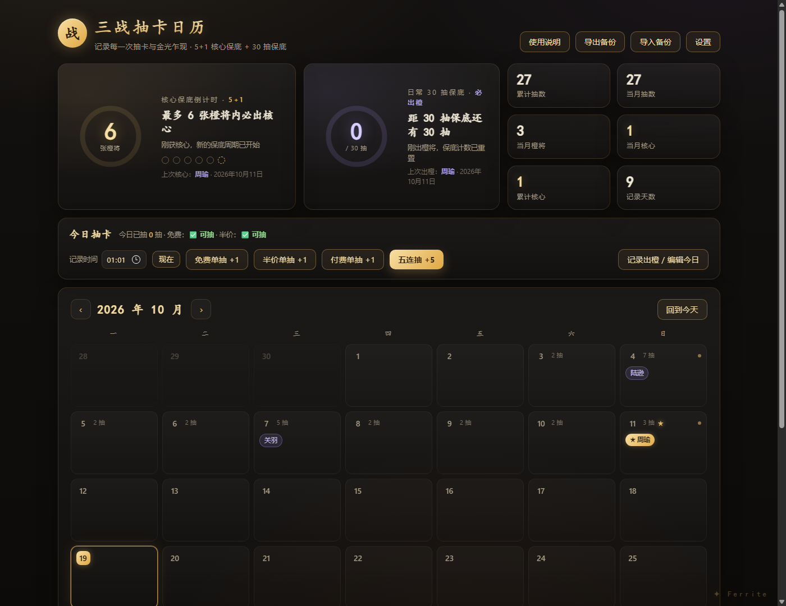

# 三战抽卡日历 · Sanzhan Gacha Calendar

> 三国志战略版 · **日常抽卡记录器** —— 单文件网页，双击即用，无需安装、无需联网，数据仅保存在你自己的浏览器里。
>
> by **Ferrite** ｜ 当前版本 **v3.0**

## ✨ 功能亮点

- **抽数记录**：免费单抽 / 半价单抽 / 付费单抽 / 五连抽（按 5 抽计算），顶部快捷按钮一键记账
- **时间自选**：记录时间默认当前时间，可改为实际抽卡时间；每一抽的时间都能单独编辑
- **橙将记录**：填武将名、区分「普通 / 核心」，日历格子直观展示
- **出自哪一抽**：每条橙将可选它来自哪一次单抽、或**五连的第几个**，保底计数精确到抽次
- **核心保底（5+1）**：连续 5 张普通橙后，下一张橙必为核心；金色圆环 + 圆点倒计时可视化
- **日常 30 抽保底**：距上次出橙的抽数累计到 30 必出橙；紫色圆环显示 X/30，出橙自动重置
- **免费 / 半价节奏**：每 11.5 小时刷新一次免费单抽（附带一次半价），约每天 4 抽；实时显示可用性与下次刷新时间
- **出橙记录**：每次出橙的日期、武将、距上次橙用了多少抽（精确到五连第几个）、平均 / 最长间隔
- **备份**：一键导出 / 导入 JSON 备份；旧版本备份同样可导入
- **双重水印与内置说明**：内置「使用说明」弹窗，随时可查

## 🚀 快速开始

**方式一：在线使用（推荐）**  
直接打开：**https://ferrite111.github.io/sgz-gacha-calendar/**

**方式二：离线使用**  
下载 `index.html`，双击用浏览器打开即可（推荐 Chrome / Edge / 手机浏览器）。

### 上手 4 步

1. 每天抽完卡，点「今日抽卡」的按钮记抽数：`免费单抽 +1`、`半价单抽 +1`、`付费单抽 +1`、`五连抽 +5`
   - 「记录时间」默认当前时间，可改成实际抽卡时间（点「现在」一键回填）
2. 出了橙将 → 点「记录出橙 / 编辑今日」：填武将名，选「普通 / 核心」，右侧「出自」选它来自哪一抽（五连可选第几个）
3. 忘了记？点日历上任意日期即可补记 / 修改
4. 定期点「导出备份」保存记录

## 🎯 保底规则说明

- **核心保底**：三战通用规律为「5+1」——连续 5 张普通橙后，第 6 张橙必为核心（按**橙将张数**计算，各卡包分开计数）
- **日常 30 抽保底**：按**抽数**计算，出橙即重置；五连中的橙将若在第 K 个出现，五连剩余（第 K+1～5 个）仍计入下一轮保底
- 两个保底分别用金色 / 紫色圆环展示，互不干扰

## 💾 数据与备份

- 数据保存在**本机浏览器**（localStorage），不上传、不联网、无任何隐私收集
- ⚠️ 清除浏览器数据 / 换浏览器 / 换设备会丢失记录——请定期「**导出备份**」
- 换设备：旧设备导出备份 → 新设备导入备份即可迁移

## ⚙️ 设置

| 设置项 | 默认 | 说明 |
|--------|------|------|
| 核心保底间隔 | 6 | 5+1 规律对应的橙将张数 |
| 日常抽卡保底 | 30 | 多少抽内必出橙将 |
| 免费刷新间隔 | 11.5 小时 | 影响免费 / 半价可用性计算 |

## ❓ 常见问题

- **同时抽多个卡池？** 各卡包保底分开计算，本工具默认汇总统计，建议只重点记录主卡池
- **旧版备份能用吗？** 可以，导入后橙将记录自动保留
- **怎么确认是最新版？** 标题栏与页脚显示 **v3.0**，顶栏有「使用说明」，快捷条有「记录时间」

## 🛠 技术说明

- 纯单文件（HTML + CSS + 原生 JS），零依赖、零构建、可离线
- 数据持久化：`localStorage`（键名 `sz_draw_cal_v2`，自动兼容 v1 数据）
- 兼容 Chrome / Edge / Firefox / Safari 及移动端浏览器

## 📄 开源协议

[MIT License](LICENSE) © 2026 **Ferrite**

转发与分发请保留作者署名。

## v3.0 更新

- 小卡包（限时）独立记录：卡包名 / 截止日期、独立 5+1 与 30 抽保底，不与大卡包及其他卡包共享；过期保底失效、记录保留
- 每个小卡包双保底卡片（核心 5+1、30 抽 + 下一抽出橙估算）
- 小卡包出橙按抽次记录（如五连第 N 抽），区分普通 / 核心
- 赛季切换：支持 S1–S8 选择与回退，大卡包保底从切换当天重置，历史记录保留
- 武将累计：大卡包 + 小卡包合并统计，核心标注，支持按次数 / 按时间排序
